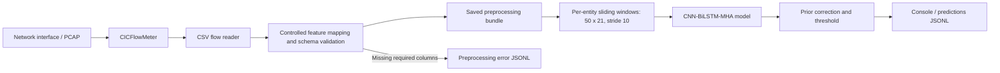

# APT-IDS — Network Intrusion Detection & Attack-Stage Classification

**Research-oriented deployment and evaluation of a CNN–BiLSTM–MultiHeadAttention network-flow classifier.**

APT-IDS organizes network flows into temporal sequences and assigns one of six labels: **BENIGN**, **COVER UP**, **DATA EXFILTRATION**, **ESTABLISH FOOTHOLD**, **LATERAL MOVEMENT**, or **RECONNAISSANCE**. This repository contains a Linux **CICFlowMeter deployment wrapper**, an **NFStream-based experimental inference path**, pretrained model and preprocessing artifacts, tests, and archived experiment results.

> **Scope / verification status:** The archived **model test-set report** and **NFStream reconnaissance experiments** are two different sources of evidence. The CICFlowMeter wrapper is included, but the archived runtime log shows a **feature-schema incompatibility that prevented inference** in that run. This repository does **not** demonstrate a fully validated end-to-end CICFlowMeter deployment. [See limitations](docs/limitations.md).

## At a glance

| Item | What is in this repository |
| --- | --- |
| Task | 6-class network-flow sequence classification (benign + five attack-stage labels) |
| Model | CNN–BiLSTM–MultiHeadAttention v4.5 Safe (saved artifact) |
| Model input | **50 consecutive flows × 21 selected features**, stride **10**, grouped by source entity when available |
| Inference decision | Prior-corrected class probabilities and calibrated attack-score threshold **0.4** |
| Model test report | **98.98% accuracy**, **85.55% macro F1**, **86,995 test windows** (archived evaluation figure) |
| Lab observations | **24 reconnaissance runs**, **405 prediction windows** recorded as RECONNAISSANCE in the saved CSV; *not* a global detection rate |
| Main caveat | CICFlowMeter archived runtime: missing two required directional flag features; no successful prediction in the supplied log |
| Artifact integrity | Existing deployment manifest has **one stale checksum** for `nfstream_adapter.py` (other 32 entries match); frozen snapshot hashes remain valid |

The model is **loaded**, not retrained, by the deployment wrapper. Model-training source code and the full original training dataset are **not** included. Model-design/training-method descriptions are based on the supplied artifact metadata, not an independent reproduction of training.

## Architecture

**A. CICFlowMeter-based deployment wrapper** (`app/`):



**B. NFStream experimental inference path** (`artifacts/inference.py`, `artifacts/nfstream_adapter_fast.py`, `generalization_test/`):


The NFStream results **must not** be presented as validation of the CICFlowMeter path. Module-by-module data flow and the point of failure are documented in [System architecture](docs/architecture.md).

## Archived evaluation evidence

### Model test-set report (offline)

| Metric | Value | Context |
| --- | ---: | --- |
| Accuracy | **98.98%** | 86,995 test windows |
| Macro F1 | **85.55%** | Each class has equal weight |
| BENIGN F1 | 99.51% | 79,520 support |
| COVER UP F1 / recall | **48.48% / 38.10%** | Only **21** test windows for this class |
| RECONNAISSANCE F1 | 95.97% | 513 support |


[Confusion matrix (counts)](artifacts/report_ready/01_test_confusion_matrix_counts.png) · [Normalized confusion matrix](artifacts/report_ready/02_test_confusion_matrix_normalized.png) · [Training curves (archived)](artifacts/report_ready/04_training_curves.png)

`artifacts/model_info.json` records a **validation-calibrated** macro F1 of approximately **90.38%** for threshold selection; it is **not** the test macro F1 above. The report image is an archived result, not a newly executed evaluation.

### NFStream reconnaissance lab results

| Test group | Distinct recorded runs | Prediction windows | Expected class in saved runs |
| --- | ---: | ---: | --- |
| Baseline | 10 | 199 | RECONNAISSANCE |
| Reconnaissance variants | 14 | 206 | RECONNAISSANCE |
| **Total** | **24** | **405** | **405/405 windows labeled RECONNAISSANCE** |

The observations are **window-level results from reconnaissance-only runs**. They do not establish a false-positive rate on benign traffic, class-wide effectiveness, production-readiness, or detection latency. Windows overlap within runs. The saved `detection_latency_seconds=0` values for the variants are **not reliable latency measurements**; see [Experiments](docs/experiments.md).

Source evidence: [results.csv](generalization_test/results/results.csv), [experiment rules](generalization_test/TEST_RULES.txt), [baseline logs](generalization_test/logs/recon_baseline/), [variant logs](generalization_test/logs/recon_variants/) and [frozen snapshot](generalization_test/frozen/snapshot_20260728_194825/).

## Repository layout

```text
APT_IDS-main/
├── README.md
├── docs/                         # Architecture, model, experiments, limitations
├── app/                          # CICFlowMeter wrapper; unchanged Python modules
├── artifacts/                    # Saved model, preprocessing, reports, NFStream adapter
├── config/config.yaml            # Original VM-specific runtime config
├── generalization_test/
│   ├── TEST_RULES.txt            # Experimental controls
│   ├── experiment.env            # Original VM-specific environment variables
│   ├── scripts/                  # Existing evaluation/verification scripts
│   ├── results/results.csv       # Existing recorded observations
│   ├── logs/                      # Existing experiment evidence
│   └── frozen/                    # Preserved reproducibility snapshot/checksums
├── scripts/                      # Existing deployment and scenario scripts
├── tests/                        # Existing tests
├── requirements.txt
└── pytest.ini
```

## Environment and original deployment instructions

This documentation **does not require you to rebuild the lab**. The commands below describe the existing wrapper, and are **not claimed to work unmodified on a new host**. The original config and experiment scripts contain absolute paths, interfaces, and virtual-environment locations specific to the archived VM.

The original deployment installer uses **Python 3.12**, with dependency pins in [requirements.txt](requirements.txt). CICFlowMeter and any system-level packet-capture prerequisites must be installed separately. The repository **does not contain** a bundled CICFlowMeter binary or sample PCAP.

```bash
# Only in a deliberately prepared Linux environment:
bash scripts/install_ubuntu.sh
# Configure CICFlowMeter commands in config/config.yaml for your local installation.

# Examples using your *own* capture/interface (illustrative, not verified here):
python -m app.main --mode pcap --pcap /path/to/your.pcap --schema-check-only
python -m app.main --mode pcap --pcap /path/to/your.pcap
python -m app.main --mode live --interface <your-interface>

# Existing tests, provided dependencies are installed:
python -m pytest
```

For schema inspection of an **already produced** CSV (without launching CICFlowMeter), see the `--skip-cicflowmeter` option in `app/main.py`; its CSV search location is `cicflowmeter.output_dir` in the YAML config. **Do not fabricate missing feature values or rename unrelated columns just to obtain a prediction.**

## Verification notes

In the original supplied bundle, `artifacts/deployment_manifest.json` has **32/33 matching hashes**; its `nfstream_adapter.py` hash/size is stale, while the frozen snapshot records the actual file hash. The model, adapter and frozen evidence have **not** been rewritten just to silence this discrepancy. See [artifact integrity and dependency compatibility](docs/limitations.md#6-artifact-integrity-and-dependency-compatibility).

A documentation-review run of `pytest` in a different environment (Python 3.13, scikit-learn 1.8.0, TensorFlow unavailable) produced **7 passed, 2 skipped, 2 failed**. Both failures involve loading an imputer saved with **scikit-learn 1.6.1** into 1.8.0; this does *not* establish failure under the repository's pinned versions. No runtime or model patch was introduced.

## Documentation

- [Architecture and component responsibilities](docs/architecture.md)
- [Model, features and preprocessing](docs/model-and-preprocessing.md)
- [Experimental design, archived results and interpretation](docs/experiments.md)
- [Known limitations and evidence boundaries](docs/limitations.md)

**Scope note:** This is a documented research/deployment artifact, not a certified production IDS. No model weights, data collection functions, evaluation scripts, frozen snapshots or tests were modified as part of the documentation clean-up.
