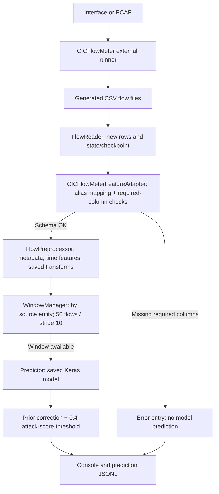
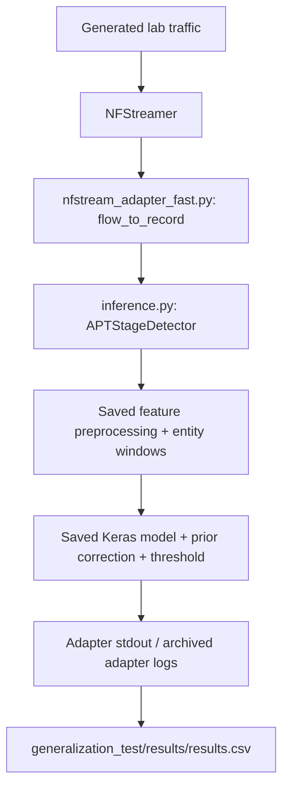

# System architecture and data flow

[← README](../README.md) · [Model & preprocessing](model-and-preprocessing.md) · [Evidence and limitations](limitations.md)

## 1. What this repository actually contains

Two inference/instrumentation paths use related **saved** model artifacts, but different network-flow extraction layers. Their results should be discussed separately.

| Aspect | CICFlowMeter deployment wrapper | NFStream experimental path |
| --- | --- | --- |
| Entry point | `app/main.py` | `artifacts/nfstream_adapter_fast.py` and related adapter variants |
| Collection | External CICFlowMeter command (live or PCAP) | NFStream `NFStreamer` (interface or capture) |
| Input to preprocessing | CSV record adapted from CICFlowMeter aliases | Native NFStream-style flow object fields |
| Stateful processing | `app/preprocessing.py`, `app/window_manager.py` | `artifacts/inference.py` (`APTStageDetector`) |
| Model | `artifacts/model.keras` | Model loaded from `--bundle`, frozen snapshot for experiments |
| Recorded outcome | Console / root `logs/predictions.jsonl` (runtime artifact, not retained in cleaned repo) | JSON output in archived experiment adapter logs; `generalization_test/results/results.csv` |
| Evidence | Archived CSV runtime failed on selected-feature schema mismatch | Recorded reconnaissance-only experiments |

The frozen model file has the same SHA-256 as the main model artifact in the supplied repository. The **input adapter is still different**, which is consequential for deployment validation.

## 2. CICFlowMeter path

### Component responsibilities

| File | Responsibility supported by source code |
| --- | --- |
| [`app/main.py`](../app/main.py) | CLI options, initialization, pipeline orchestration, recording prediction **or** preprocessing error |
| [`app/cicflowmeter_runner.py`](../app/cicflowmeter_runner.py) | Starts and stops CICFlowMeter commands specified in config |
| [`app/flow_reader.py`](../app/flow_reader.py) | Reads CSV files, remembers already processed rows in state/checkpoint for live polling |
| [`app/feature_adapter.py`](../app/feature_adapter.py) | Controlled naming/units conversion; checks selected features; rejects unsupported source columns |
| [`app/preprocessing.py`](../app/preprocessing.py) | Loads saved model-adjacent artifacts; derives time values; categorical mapping, imputation, outlier clipping, scaling |
| [`app/window_manager.py`](../app/window_manager.py) | Per-entity flow buffer and sliding sequence emission |
| [`app/predictor.py`](../app/predictor.py) | Saved model prediction, training-prior correction, threshold-based stage decision |
| [`app/logging_utils.py`](../app/logging_utils.py) | Formatting and writing runtime logs/JSONL |
| [`config/config.yaml`](../config/config.yaml) | Original VM-specific CICFlowMeter commands, output locations, runtime settings, aliases |

**Processing granularity:** source-entity sequences, not packet-by-packet alerts. The window manager waits for 50 flow records for the entity, then emits a new window every 10 additional flows. This affects when an outcome can be produced and why per-window records are not independent attacks.

**Failure boundary:** the adapter requires all *selected* non-derived features. For the supplied CICFlowMeter runtime CSV it could not supply `src2dst_rst_packets` and `dst2src_ack_packets`, so processing stopped before inference. See [Known limitations](limitations.md).

## 3. NFStream experimental path

The experiment scripts [`run_recon_baseline_ubuntu.sh`](../generalization_test/scripts/run_recon_baseline_ubuntu.sh) and [`run_recon_variants_ubuntu.sh`](../generalization_test/scripts/run_recon_variants_ubuntu.sh) invoke **`nfstream_adapter_fast.py`** from the **frozen snapshot**. Their CSV and log output cannot establish that the CICFlowMeter CSV adapter emits the identical features, distributions or predictions.

### Experiment provenance

- [`generalization_test/experiment.env`](../generalization_test/experiment.env) captures **original VM paths, IPs, interfaces and locations**. These are archival details, not portable defaults.
- [`generalization_test/TEST_RULES.txt`](../generalization_test/TEST_RULES.txt) documents the intended evaluation controls.
- [`generalization_test/frozen/snapshot_20260728_194825/`](../generalization_test/frozen/snapshot_20260728_194825/) preserves model, preprocessing, scripts, environment record and `SHA256SUMS.txt`.
- [`generalization_test/scripts/verify_frozen.sh`](../generalization_test/scripts/verify_frozen.sh) contains the original snapshot verification command; its sourced `.env` paths must be adapted to a different machine before execution. The snapshot contents themselves have **not been rewritten**.

## 4. Deployment versus model evidence

The archived offline classifier report documents performance on a held-out test split recorded by the original evaluation. The saved reconnaissance lab CSV documents the NFStream-specific trials. The supplied CICFlowMeter runtime log documents a schema failure. These are **three distinct kinds of evidence**—none substitutes for the others.

Further detail: [model features](model-and-preprocessing.md), [experimental counts](experiments.md), [known limitations](limitations.md).
