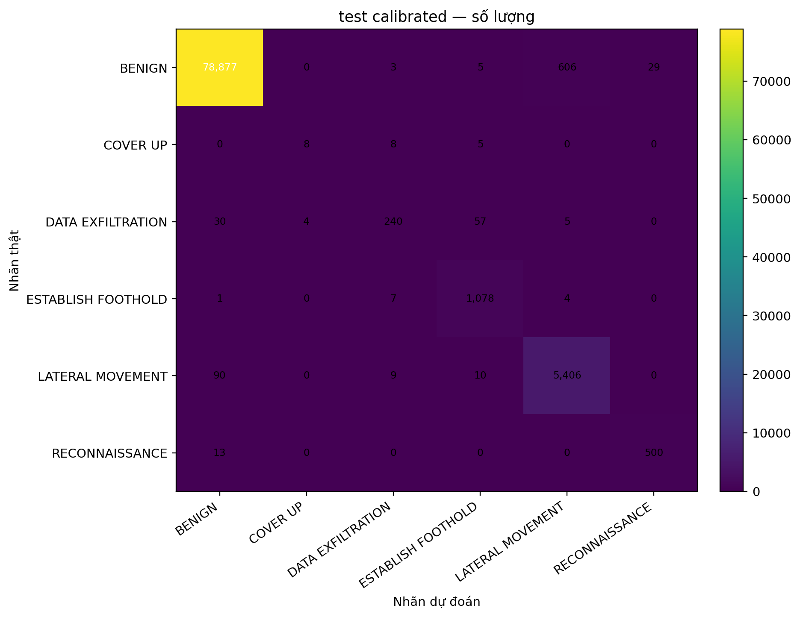
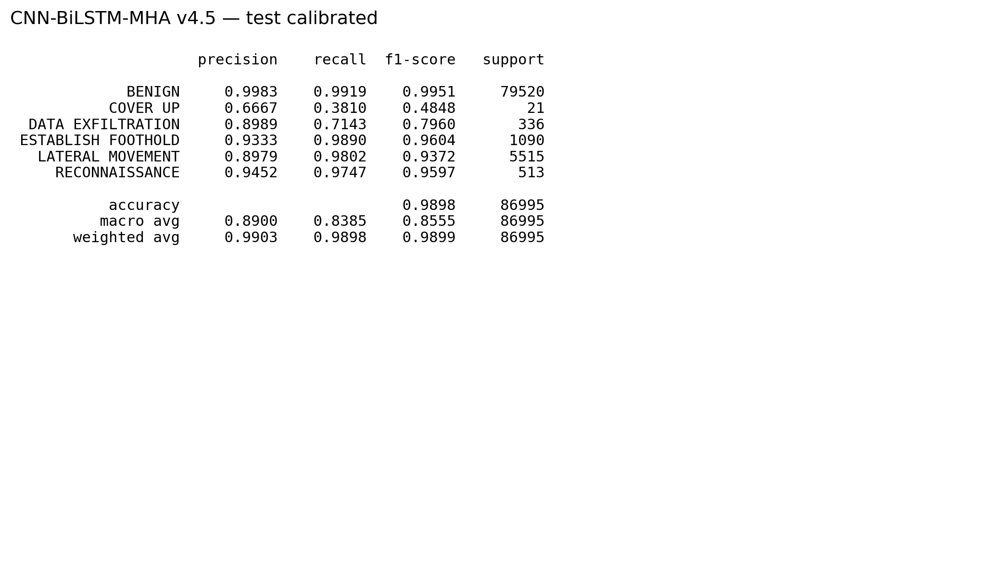

# Model and preprocessing artifacts

[← README](../README.md) · [Architecture](architecture.md) · [Experiments](experiments.md)

## 1. Task and saved model

- **Task:** 6-class supervised *flow-sequence* classification, not a signature rule set.
- **Architecture name recorded by metadata:** CNN–BiLSTM–MultiHeadAttention v4.5 Safe (`artifacts/model_info.json`).
- **Saved model:** [`artifacts/model.keras`](../artifacts/model.keras).
- **Model input:** `(50, 21)` (50 flows per sequence, 21 selected features), stride `10`.
- **Grouping:** source IP when available; fallback to a global metadata entity in the wrapper.
- **Labels:** `BENIGN`, `COVER UP`, `DATA EXFILTRATION`, `ESTABLISH FOOTHOLD`, `LATERAL MOVEMENT`, `RECONNAISSANCE` (see [`label_mapping.csv`](../artifacts/label_mapping.csv)).
- **Decision:** correct raw probabilities using stored natural/sampled training priors; compute attack score `1 - P(BENIGN)`; if below `0.4`, predict `BENIGN`; otherwise choose the highest-scoring non-benign label. This is implemented in [`app/predictor.py`](../app/predictor.py) and [`artifacts/inference.py`](../artifacts/inference.py).

The repository includes the **inference artifact**, not the complete model definition/training notebook. The saved metadata lists the following training/design methods: `MI+SU+mRMR` feature selection; dropout-contrastive representation pretraining; focal loss with bounded class weighting; dropout and L2 regularization; prior correction and validation-only threshold calibration. These are **metadata claims about the archived model** and are not independently re-derived here.

## 2. Feature selection and transforms

The saved selection has **21 features**:

| Feature grouping (descriptive) | Selected features |
| --- | --- |
| Directional TCP flags | `src2dst_rst_packets`, `dst2src_ack_packets`, `bidirectional_rst_packets`, `bidirectional_ack_packets` |
| Flow volume | `bidirectional_bytes`, `src2dst_bytes`, `dst2src_bytes` |
| Packet size statistics | `src2dst_max_ps`, `bidirectional_max_ps`, `src2dst_mean_ps`, `dst2src_max_ps`, `dst2src_mean_ps`, `bidirectional_stddev_ps`, `bidirectional_mean_ps`, `src2dst_stddev_ps` |
| Packet inter-arrival time | `bidirectional_mean_piat_ms`, `dst2src_stddev_piat_ms`, `src2dst_mean_piat_ms`, `bidirectional_max_piat_ms`, `dst2src_mean_piat_ms` |
| Flow duration | `bidirectional_duration_ms` |

These names and their saved order come from [`artifacts/preprocessing_config.json`](../artifacts/preprocessing_config.json) and [`feature_schema.json`](../artifacts/feature_schema.json). Not all CICFlowMeter builds expose the required directional flags; aliasing must reflect actual measurements, never invented values.

Saved preprocessing is loaded from [`preprocessor_bundle.joblib`](../artifacts/preprocessor_bundle.joblib). The pipeline reconstructs metadata-derived time features in its feature frame, encodes categorical values via saved frequency maps, converts numerical values, replaces non-finite values with missing values, imputes missing values, applies recorded outlier clipping, selects the trained feature subset, and scales to the model input. See [`app/preprocessing.py`](../app/preprocessing.py).

## 3. Dataset split and class imbalance metadata

The archived [`preprocessing_config.json`](../artifacts/preprocessing_config.json) records:

| Field | Saved value |
| --- | --- |
| Split mode | `block_stratified_random` |
| Train / validation / test ratio | `0.70 / 0.15 / 0.15` |
| Train windows after saved sampling | 305,928 |
| Validation windows | 85,959 |
| Test windows | 86,995 |
| Training imbalance treatment | `moderate_benign_undersampling_no_sequence_smote` |
| Outlier handling | Clip, stored z-score threshold = 5 for configured columns |

The original dataset is referenced by a local Kaggle pipeline path in the metadata; it is **not packaged in the repository**. The train/validation/test splitting and training claims cannot be independently rerun from the supplied files. With temporally overlapping windows, interpretation also depends on how split boundaries and flow entities were handled in the original upstream workflow.

## 4. Threshold selection vs held-out test results

[`threshold.json`](../artifacts/threshold.json) records a **validation-calibrated** threshold of `0.4`, validation macro F1 `0.9038176566` (about **90.38%**) and benign false positive rate `0.0085519032` (about **0.86%**) at that operating point.

The separate **test report image** reports accuracy **98.98%** and macro F1 **85.55%** across **86,995** windows. These are not interchangeable results; use each with its appropriate split label.

The low-support `COVER UP` class (21 test windows) has F1 **48.48%** and recall **38.10%**. Aggregate accuracy is dominated by benign windows and should not be interpreted as uniform detection quality across attack stages.

## 5. Artifact map

| Artifact | Purpose |
| --- | --- |
| [`model.keras`](../artifacts/model.keras) | Saved Keras model |
| [`preprocessor_bundle.joblib`](../artifacts/preprocessor_bundle.joblib) | Saved fitted preprocessing objects and settings |
| [`threshold.json`](../artifacts/threshold.json) | Calibrated threshold and validation metrics |
| [`model_info.json`](../artifacts/model_info.json) | Declared architecture and selection basis |
| [`preprocessing_config.json`](../artifacts/preprocessing_config.json) | Sequence settings, feature selection, split metadata |
| [`feature_schema.json`](../artifacts/feature_schema.json) | Expected column names and field metadata |
| [`deployment_manifest.json`](../artifacts/deployment_manifest.json) | Listed artifact hashes/sizes in the supplied bundle |
| [`report_ready/`](../artifacts/report_ready/) | Archived evaluation figures (not newly reproduced) |

The existing repository's binary model and data artifacts were preserved unchanged in the cleaned version. The original deployment manifest contains one stale SHA-256/size entry for `nfstream_adapter.py`, although the frozen snapshot hashes validate; see [Known limitations: artifact integrity](limitations.md#6-artifact-integrity-and-dependency-compatibility).
